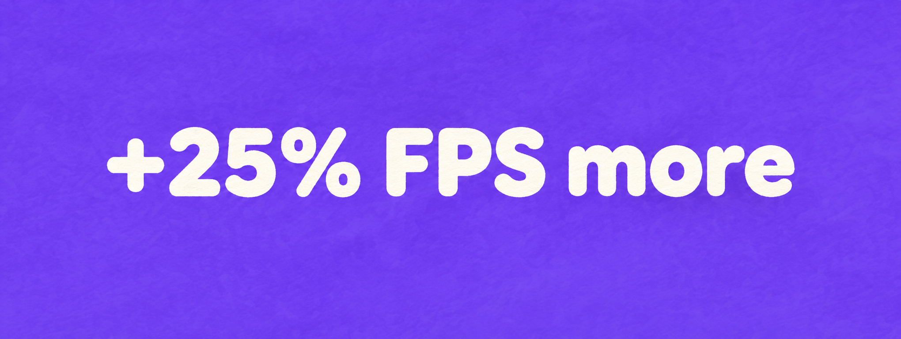
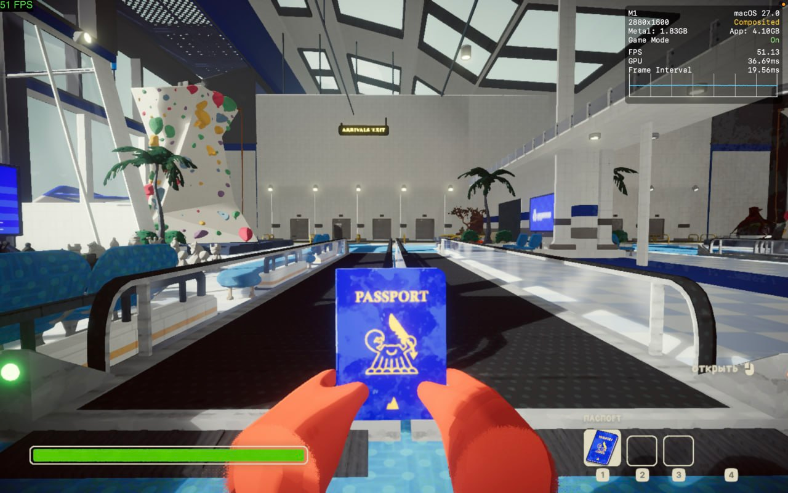

# MaciPEAK


[English instructions](README.md)

MaciPEAK собирает нативное приложение `PEAK.app` для macOS из вашей Windows-копии PEAK в Steam. Поддерживается **PEAK 3.1.0, BuildID 26542162**. Сборщик работает на Apple silicon и Intel. Проект неофициальный.

## Производительность



| Mac | CrossOver | MaciPEAK |
| --- | ---: | ---: |
| MacBook Air M1 | ~40 FPS | ~52 FPS |

Примерная частота кадров в сцене аэропорта.

<details>
<summary>Настройки графики для сравнения</summary>

| Настройка | Значение |
| --- | --- |
| Режим отображения | В окне |
| Разрешение | 1440 × 900 |
| Макс. частота кадров | 400 |
| Верт. синхронизация | Выкл. |
| Масштаб отображения | Среднее |
| Дальность теней | Среднее |
| Качество текстур | Наилучшее |
| Качество мира | Среднее |
| Фоновое затенение | Вкл. |

</details>



*MaciPEAK Airport on M1*

## Как получить Windows-файлы PEAK на Mac

Если на Windows уже установлена PEAK 3.1.0 (BuildID 26542162), скопируйте целиком папку `steamapps/common/PEAK` на Mac или внешний диск. Эту же Windows-сборку можно скачать напрямую через Steam на macOS.

1. Откройте Steam на Mac под аккаунтом с купленной PEAK. Чтобы открыть вкладку **Console** в Steam, выполните в Терминале `open 'steam://open/console'`.
2. Введите следующую команду **в консоли Steam**. Она скачивает Windows-депо по манифесту поддерживаемой сборки. Для файлов потребуется около 15,3 ГиБ свободного места.

   ```text
   download_depot 3527290 3527291 719488143636267246
   ```

3. Дождитесь сообщения `Depot download complete`. Steam выведет полный путь к папке `depot_3527291`. Выберите её в MaciPEAK Builder или передайте путь в `sh build.sh --game`. В папке должны быть `PEAK.exe`, `version.txt` и `PEAK_Data`.

## Сборка через приложение

1. Скачайте и откройте [образ MaciPEAK Builder](https://github.com/TsiFroviK/MaciPEAK/releases/latest/download/MaciPEAK-Builder-macOS.dmg), перетащите **MaciPEAK Builder** в **Программы** и запустите его из этой папки.
2. Войдите в Steam на Mac под аккаунтом с лицензией PEAK и откройте карточку игры в библиотеке. Завершите запущенные игры Steam. На томе APFS или Mac OS Extended понадобится около 30 ГБ свободного места сверх размера Windows-копии.
3. Выберите папку с `PEAK.exe` и нажмите **Собрать**. В **Дополнительных параметрах** можно выбрать Apple silicon, Intel или универсальную игру для обоих процессоров. По умолчанию выбрана архитектура вашего Mac.
4. MaciPEAK зарегистрирует сборку, затем откроет Steam или перезапустит уже работающий клиент. Выберите **Библиотека → PEAK → Играть**. Приложение использует тот же сценарий сборки, что и команда для Terminal ниже.

При запуске сборщик проверяет обновления в GitHub Releases. Проверку можно запустить вручную через **MaciPEAK Builder → Проверить обновления…**. Перед обновлением скопируйте сборщик в **Программы**. Кнопка **Обновить** установит новую версию и перезапустит сборщик. **Позже** отложит установку, а **Не напоминать** отключит автоматические напоминания об этой версии.

У опубликованного сборщика локальная подпись. Если при первом открытии macOS запросит подтверждение, воспользуйтесь [инструкцией Apple по запуску загруженных приложений](https://support.apple.com/ru-ru/102445).

Если в библиотеке уже есть совместимая `PEAK.app`, кнопка **Собрать** восстановит её регистрацию в Steam. Для пересборки закройте PEAK и сначала перенесите старую `PEAK.app` из `steamapps/common/PEAK` в резервную папку на том же диске. Папка Windows-версии и файлы Steam должны остаться на месте.

## Сборка на Mac

1. Получите [файлы поддерживаемой Windows-версии](#как-получить-windows-файлы-peak-на-mac).
2. Распакуйте архив этого репозитория и откройте в Terminal каталог с `build.sh`. Для приложения выберите том APFS или Mac OS Extended. Для первой сборки отведите около 30 ГБ свободного места **сверх размера Windows-копии**. Нужны интернет и инструменты командной строки Apple.
3. Для установки в библиотеку откройте Steam на Mac под аккаунтом с лицензией PEAK. Откройте карточку PEAK, чтобы клиент загрузил сведения об игре. Завершите запущенные игры Steam и подставьте путь к своей Windows-копии.

```sh
sh build.sh --game "/Volumes/Games/PEAK"
```

По умолчанию скрипт собирает универсальное приложение. Добавьте `--arch arm64` для Apple silicon или `--arch x86_64` для Intel.

По умолчанию приложение появится в `steamapps/common/PEAK/PEAK.app` внутри библиотеки Steam. Для внешней библиотеки добавьте `--steam-library "/Volumes/Games/SteamLibrary"`. На диске exFAT можно хранить Windows-файлы. Для библиотеки на таком диске используйте образ APFS и монтируйте его перед запуском Steam. Для отдельной сборки под Finder укажите `--output "/путь/к/PEAK.app"` с существующим родительским каталогом.

4. После регистрации сборщик откроет Steam или перезапустит уже работающий клиент. В аккаунте с лицензией PEAK откройте **Библиотека → PEAK → Играть**. Игра использует свой Steam AppID `3527290`. [PEAK в Steam](https://store.steampowered.com/app/3527290/PEAK/)

При первом запуске PEAK открывается на весь экран без рамки. Чтобы играть в окне, в настройках графики смените режим экрана на оконный. Игра запомнит выбор для следующих запусков.

В macOS пресет **Среднее** рисует сцену в 65% выбранного разрешения по каждой оси перед масштабированием Unity STP. Дальние надписи становятся чётче, при этом растёт нагрузка на GPU.

На macOS 14 и новее сборщик запускает проверку Gatekeeper в конце сборки, когда игра уже лежит в папке установки. После этого можно сразу запускать игру. Если переместить или изменить приложение, macOS может проверить его повторно.

### Регистрация в Steam и оверлей

Издатель PEAK поставляет параметры запуска для Windows. MaciPEAK добавляет в локальный каталог Steam вариант запуска для macOS и регистрирует установку в библиотеке. Steam может обновить этот каталог. Если кнопка «Играть» исчезла или клиент был занят при завершении сборки, восстановите регистрацию одной командой. Для внешней библиотеки укажите тот же `--steam-library`.

```sh
sh build.sh --register-steam
```

Если после тестирования PEAK через CrossOver NotProton Steam поставил в очередь обновление Windows-версии, отключите принудительный выбор инструмента в **PEAK → Свойства → Совместимость**. Повторно запустите сборщик, чтобы он восстановил нативную установку и перезапустил Steam.

Чтобы удалить локальную регистрацию и сохранить приложение, выполните `sh build.sh --unregister-steam` с той же библиотекой. Для оверлея откройте PEAK кнопкой **Играть** в Steam и нажмите **Shift+Tab** после появления главного меню. Оверлей включается в **Steam → Настройки → В игре** и в **PEAK → Свойства → Общие**. На M1 кнопка «Играть» запустила версию arm64, а два нажатия Shift+Tab открыли и закрыли оверлей. [Оверлей Steam](https://help.steampowered.com/ru/faqs/view/3978-072C-18DF-FBF9)

## Зависимости

Сборщик ищет Unity **6000.3.15f1 (c1aa84e375f6)** и модуль Mac Mono. Unity Hub устанавливать отдельно не требуется. На чистом Mac сборщик сам скачивает универсальный плеер (около 725 МБ) и читает первые 1032 МиБ официального пакета редактора. Из них он извлекает 30 библиотек Mono для macOS, проверяет контрольную сумму каждой и сохраняет в кэше около 20 МиБ библиотек. [Релиз и установщики Unity](https://unity.com/releases/editor/whats-new/6000.3.15f1)

MaciPEAK использует подходящие Python и компилятор C# из системы либо скачивает их для сборки. Автоматически загружаются библиотеки Python, инструменты перевода шейдеров, Steamworks.NET, EOS для macOS, Mono.Cecil и Xiph Opus. Установкой Command Line Tools при необходимости управляет установщик Apple. [Источники и лицензии зависимостей](THIRD_PARTY.md)

Загрузки и промежуточные шейдеры хранятся в `.macipeak-cache` в корне библиотеки Steam или рядом с отдельным приложением. Через `--cache DIR` можно выбрать другой каталог, а через `--editor PATH` и `--support PATH` — передать подходящую установленную Unity или заранее скачанные пакеты. Параметр `--deps DIR` принимает локальные SDK и совместимый `PhotonVoice.unitypackage` для дополнительной обработки WebRTC. Обычный голосовой тракт использует микрофон Unity и Opus. Полный список параметров выводит `sh build.sh --help`.

## Что собирается локально

Сцены, материалы, карты, графические программы и игровые сборки читаются из вашей установки. MaciPEAK переводит шейдеры в Metal, применяет исправления рендера и доступа к микрофону, собирает нативные библиотеки совместимости и формирует приложение на базе плеера Unity для macOS. Перед установкой сборщик проверяет выбранные архитектуры и локальную подпись приложения.

Чтобы подготовить сборщик для Releases, выполните на Mac с Command Line Tools команду `sh scripts/package-gui.sh MaciPEAK-Builder-macOS.dmg`. Образ содержит универсальное приложение и сценарии сборки. Для упаковки в ZIP укажите имя файла с расширением `.zip`. Файлы PEAK для упаковки не требуются. По умолчанию используется локальная подпись. Для нотарификации задайте в `MACIPEAK_SIGN_IDENTITY` имя сертификата Developer ID Application, а в `MACIPEAK_NOTARY_PROFILE` — имя профиля notarytool из Связки ключей. Сценарий подпишет приложение и образ, отправит образ в Apple и прикрепит полученный билет. [Документация Apple](https://developer.apple.com/documentation/security/notarizing-macos-software-before-distribution)

Иконку для Finder и Dock сборщик создаёт из ресурсов вашего `PEAK.exe`.

На MacBook Air M1 сопоставлены 12 видов на `Level_0` и `Level_32` с Windows-версией под Direct3D 11. Обычная посадка в аэропорту также загрузила `Level_111` в режимах arm64 и x86_64 через Rosetta 2. Запуск на физическом Intel Mac и голосовая связь со вторым игроком пока не проверены.

Исходники сборщика и собственный код совместимости MaciPEAK распространяются по [лицензии MIT](LICENSE). Используйте собственную лицензионную копию PEAK. Собранное приложение, входные файлы Steam и кэш остаются у пользователя. [Уведомления о сторонних компонентах](THIRD_PARTY.md)
